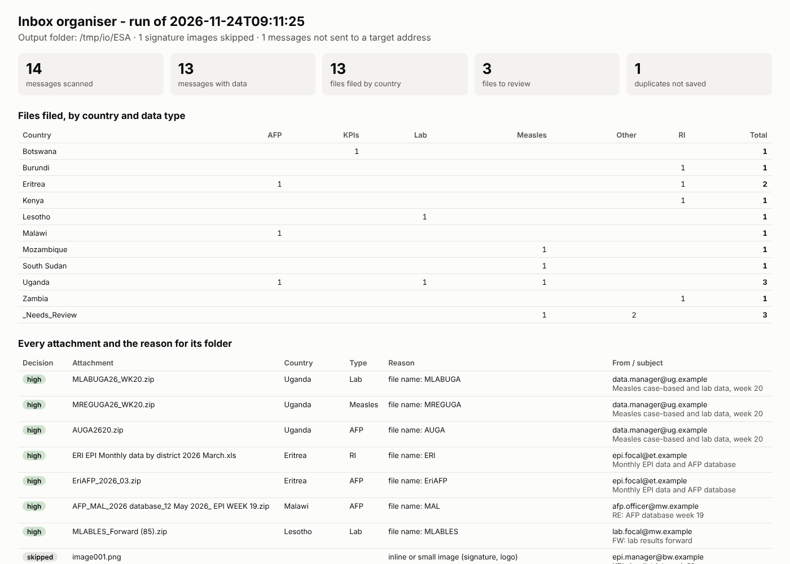

# RI inbox organiser

[](https://github.com/stevebanza/ri-inbox-organiser/actions/workflows/ci.yml)

**A regional immunization team receives dozens of country files every week by e-mail:** AFP databases, measles case-based and lab files, monthly RI data, KPI tables. Before any analysis can start, someone has to open each message, work out which country and which kind of data it is, and save it in the right folder.

This tool does that. It reads the mailbox (Outlook desktop, or a folder of exported `.eml` files) and decides **the country and the data type of each attachment**. It saves the file to `Country/DataType/`, and records why each file went where it did.

> **Demo data is synthetic.** The e-mails, senders and files in the demo are invented. Country names are real because they are the folder names, but no file contains real data. Real mailbox settings stay in a local `.env` file that is never committed.



---

## The problem it solves

The first version of this tool read the subject, the body, the sender and the file names as one block of text, and took the longest country name it found. In real use, that filed files in the wrong country:

| Message | First version filed it in | Correct | Why the first version was wrong |
| --- | --- | --- | --- |
| `ERI EPI Monthly data…`, `EriAFP_2026_03.zip`, sent by the Ethiopia office | Ethiopia | **Eritrea** | The signature says Ethiopia; the file codes ERI and Eri were never read |
| `AFP_MAL_2026 database…`, a reply to a regional thread | Mozambique | **Malawi** | The quoted thread below the reply named Mozambique |
| `MLABLES_Forward.zip`, forwarded by a Malawi lab focal point | Malawi | **Lesotho** | The sender and body are Malawi; MLABLES is Lesotho's lab file |
| One message with Kenya and Zambia files | Zambia (both) | **Kenya, Zambia** | One country per message |
| A file whose subject names two countries | Botswana | **Review** | It guessed instead of asking |

It also saved every signature logo (`image001.png`…) as data, and saved the same files again (`_1`, `_2`…) each time it ran.

On the demo inbox, the first version files **9 of 17** data files correctly; this version files **17 of 17**. Three of them go to review on purpose, because there's nothing reliable to decide on.

---

## How a file is classified

Each **attachment** is decided on its own, so one e-mail can deliver files for several countries. The evidence is weighed from the strongest to the weakest:

| Evidence | Weight | Examples |
| --- | :---: | --- |
| **The file name**: a country code or country name | 5 | `AUGA2612` (A + UGA), `MLABMAL2611`, `AFPLES`, `EriAFP`, `Measles_RSS_Wk20`, `Kenya RI data` |
| **The subject** | 3 | "Données PEV du Burundi" |
| **The sender's e-mail domain** | 2 | `…@mw.example` → Malawi |
| **The body**, after removing quoted replies and forwarded threads | 1 | a signature naming the country |

The decision follows three rules:
- **If the file name points to one country, that decides.** It's what the country itself put on the file.
- **Otherwise the scores are added up.** A file goes to **`_Needs_Review`** in either of two cases:
  - the best score is weak (a single mention in the body is not enough);
  - two countries are close (the runner-up has 75% or more of the best score).
- **The reason is written down** for every file, so a wrong decision can be traced and the configuration fixed.

Country codes inside file names follow the naming used in surveillance exchanges: a code may carry a prefix (`A`, `M`, `AFP`, `MLAB`, `MREG`…) or a suffix (`AFP`, `MEASLES`). It must fill a whole word. So `Measles` is not Lesotho (LES), `Malaria` is not Malawi (MAL), and `Communication` is not Comoros (COM). The tests check each of these.

**The data type** comes from the file name, then the subject:

| Subfolder | Matches |
| --- | --- |
| Lab | MLAB, MLAM, lab, laboratory |
| AFP | AFP, polio, `A` + country code + digits |
| Measles | measles, rubella, rougeole, MREG, `M` + country code + digits |
| KPIs | KPI, indicators |
| RI | EPI, RI, RID, immunization, utility, PEV, vaccine |

---

## What else it does

- **Filters by recipient and date.** Only mail sent (To or Cc) to the team's data addresses within the last *n* days is read.
- **Skips decorations.** Inline images and small pictures (signature logos) are skipped.
- **Never saves the same file twice.** Each file is fingerprinted (SHA-256), so a re-sent attachment, or a second run over the same mail, is recorded as a *duplicate* and not saved again.
- **Unzips archives safely.** Each `.zip` is extracted next to itself, and an archive can't write outside its own folder.
- **Keeps a manifest.** `_manifest.csv` holds one line per attachment: date, sender, subject, country, type, confidence, reason, fingerprint, status and path.
- **Writes a run report.** `_reports/run_<time>.html` shows the counts by country and type, and every attachment with its reason.
- **Has a dry run.** `--dry-run` shows every decision and saves nothing. Use it before pointing the tool at a real mailbox for the first time.

---

## Running it

```bash
python -m venv .venv && source .venv/bin/activate     # Windows: .venv\Scripts\activate
pip install -r requirements.txt

python organise.py --demo                 # writes the synthetic inbox, then files it
pytest -q                                 # 36 tests
```

On a real mailbox (Windows with Outlook desktop):

```powershell
copy .env.example .env                     # then put your real addresses in .env
python organise.py --source outlook --dry-run --days 7
python organise.py --source outlook --days 30
python organise.py --source outlook --outlook-folder "Inbox/RI data"
```

Or on exported mail: `python organise.py --source eml --eml-dir path\to\folder`.

Everything that varies between teams is in **`config.yaml`**, so no code changes are needed:
- the countries, with their other names, file codes and ministry e-mail domains;
- the data types;
- the evidence weights and review thresholds;
- the image size limit;
- whether to unzip archives.

---

## The demo inbox

`organise.py --demo` writes 14 messages that reproduce the situations above. The tests check every one of them:

| Situation | Result |
| --- | --- |
| Uganda weekly lab, measles and AFP files | Uganda / Lab, Measles, AFP |
| Eritrea files sent by the Ethiopia office | Eritrea / RI, AFP |
| Malawi AFP database in a thread that names Mozambique | Malawi / AFP |
| Lesotho lab file forwarded from Malawi | Lesotho / Lab |
| Botswana KPIs with a signature logo | Botswana / KPIs (decided by sender and signature); logo skipped |
| The same Botswana file re-sent | Duplicate, not saved again |
| One message with Kenya and Zambia files | Kenya / RI and Zambia / RI |
| South Sudan measles (`RSS`), Mozambique measles-rubella, Burundi in French (`BDI`, PEV) | Their country / Measles or RI |
| No country anywhere; two countries for one file; one mention in the body only | `_Needs_Review`, with the reason |
| Mail not sent to the data address | Ignored |

---

## Repository layout

```
config.yaml            countries, codes, domains, data types, weights, thresholds
.env.example           where real recipient addresses and the output folder go (copy to .env)
organise.py            command line
organiser/
  sources.py           Outlook desktop (pywin32) and .eml folder readers
  classify.py          evidence from file name, subject, sender, body; the decision rules
  store.py             folders, de-duplication, safe unzip, manifest
  process.py           filters (recipient, decorations) and the main loop
  report.py            HTML run report
  demo.py              synthetic inbox
  legacy.py            the first version's rule, kept to show what changed
tests/                 36 tests, run in CI on every push
```

Steve KUBENGA BANZA, PMP · Data Management and Analytics · [LinkedIn](https://www.linkedin.com/in/stevekubengabanza/) · MIT License
